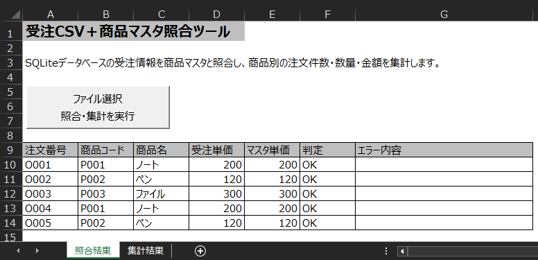
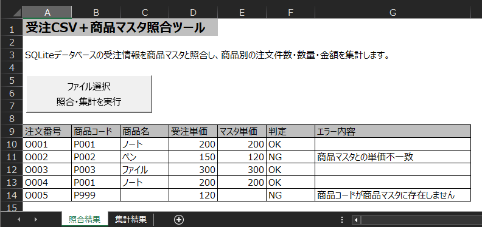
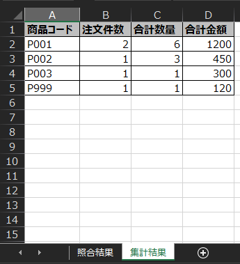

# 受注CSV＋商品マスタ照合ツール（VBA＋SQLite版）

Excel VBAとSQLiteを使用して作成した、受注データの商品マスタ照合・商品別集計ツールです。

SQLiteデータベースに登録された受注情報を商品マスタと照合し、OK／NG判定、エラー内容の表示、商品別の注文件数・合計数量・合計金額の集計を行います。

## 想定する利用シーン

SQLiteデータベースに保存された受注情報と商品マスタを照合し、商品コードや単価の確認、エラー内容の確認、商品別の集計を行う定型業務を想定しています。

※実在する業務システムを再現したものではなく、Excel VBAとSQLiteを組み合わせた業務データの照合・集計処理のサンプルとして作成しています。

## 主な機能

- sqlite3.exeを使用したSQLの実行
- SQLによる受注データと商品マスタの照合
- 商品コードの存在確認
- 商品マスタの標準単価と受注単価の照合
- 各行のOK／NG判定
- エラー内容の表示
- 商品別の注文件数の集計
- 商品別の合計数量の集計
- 商品別の合計金額の集計
- Excelシートへの照合結果・集計結果の出力
- 出力件数に応じた罫線の自動設定

## 想定するデータベース構成

SQLiteデータベースに、以下の2つのテーブルを用意します。

### orders（受注データ）

| カラム名 | 内容 |
|---|---|
| order_number | 注文番号 |
| order_date | 受注日 |
| product_code | 商品コード |
| quantity | 数量 |
| unit_price | 受注単価 |

サンプル：

| order_number | order_date | product_code | quantity | unit_price |
|---|---|---|---:|---:|
| O001 | 2026-10-01 | P001 | 2 | 200 |
| O002 | 2026-10-01 | P002 | 3 | 120 |
| O003 | 2026-10-02 | P003 | 1 | 300 |
| O004 | 2026-10-02 | P001 | 4 | 200 |
| O005 | 2026-10-03 | P002 | 1 | 120 |

### products（商品マスタ）

| カラム名 | 内容 |
|---|---|
| product_code | 商品コード |
| product_name | 商品名 |
| standard_unit_price | 標準単価 |

サンプル：

| product_code | product_name | standard_unit_price |
|---|---|---:|
| P001 | ノート | 200 |
| P002 | ペン | 120 |
| P003 | ファイル | 300 |

商品マスタと受注データは、SQLiteデータベース内の別テーブルとして管理します。

## チェック内容

SQLの`LEFT JOIN`を使用して、`orders`テーブルを基準に`products`テーブルと照合します。

### 商品コード

受注データの商品コードが、商品マスタに存在することを確認します。

存在しない場合はNGとし、以下のエラーを表示します。

`商品コードが商品マスタに存在しません`

### 単価

受注データの`unit_price`と、商品マスタの`standard_unit_price`が一致することを確認します。

一致しない場合はNGとし、以下のエラーを表示します。

`商品マスタとの単価不一致`

### チェック結果

「照合結果」シートの以下の列に表示します。

| 列 | 項目 |
|---|---|
| A | 注文番号 |
| B | 商品コード |
| C | 商品名 |
| D | 受注単価 |
| E | マスタ単価 |
| F | 判定 |
| G | エラー内容 |

F列に、問題がない行は`OK`、問題がある行は`NG`と表示します。

G列には、NGとなった理由を表示します。

判定にはSQLの`CASE`式を使用しています。

## 集計

SQLの`GROUP BY`、`COUNT`、`SUM`を使用して、商品コード別に集計します。

集計内容は以下のとおりです。

- 注文件数：`COUNT(*)`
- 合計数量：`SUM(quantity)`
- 合計金額：`SUM(quantity * unit_price)`

集計に使用するSQL：

```sql
SELECT
    product_code,
    COUNT(*) AS order_count,
    SUM(quantity) AS total_quantity,
    SUM(quantity * unit_price) AS total_amount
FROM orders
GROUP BY product_code;
```

集計結果は「集計結果」シートに表示します。

正常データの場合の例：

| 商品コード | 注文件数 | 合計数量 | 合計金額 |
|---|---:|---:|---:|
| P001 | 2 | 6 | 1200 |
| P002 | 2 | 4 | 480 |
| P003 | 1 | 1 | 300 |

なお、集計は`orders`テーブルの全レコードを対象としています。

そのため、商品マスタとの照合結果がNGとなった受注データも集計対象に含まれます。

## 使い方

1. `受注CSV＋商品マスタ照合ツール(SQLite).xlsm`を開きます。
2. マクロを有効にします。
3. 「照合結果」シートの「ファイル選択・照合・集計を実行」ボタンを押します。
4. SQLite公式コマンドラインツールの`sqlite3.exe`を選択します。
5. 対象のSQLiteデータベース（`.db`ファイル）を選択します。
6. 「照合結果」シートで各行の判定結果とエラー内容を確認します。
7. 「集計結果」シートで商品別の注文件数・合計数量・合計金額を確認します。

## スクリーンショット

### 照合結果（正常データ）

すべての受注データが商品マスタと一致している場合の例です。



### 照合結果（異常データ）

商品マスタとの単価不一致、および商品マスタに存在しない商品コードを含む場合の例です。



### 商品別集計

商品別の注文件数・合計数量・合計金額を表示します。

以下は異常データを含むデータベースで集計した場合の例です。



## サンプルデータベース

`sample`フォルダに以下の2つのSQLiteデータベースを用意しています。

### order_checker_ok.db

すべて正常な受注データを含むサンプルです。

- 受注データ5件
- 商品マスタとの照合結果はすべてOK
- 商品別の注文件数・合計数量・合計金額の集計確認用

### order_checker_ng.db

異常な受注データを含むサンプルです。

- 受注データ5件
- O002：商品マスタとの単価不一致
- O005：商品マスタに存在しない商品コード（P999）
- OK／NG判定とエラー内容の表示確認用
- NGデータを含む場合の集計確認用

## ファイル構成

```text
OrderChecker_SQLite/
├── 受注CSV＋商品マスタ照合ツール(SQLite).xlsm
├── src/
│   └── Module1.bas
├── sample/
│   ├── order_checker_ok.db
│   └── order_checker_ng.db
├── images/
│   ├── check_ok.png
│   ├── check_ng.png
│   └── summary.png
└── README.md
```

## 動作環境

- Windows 11
- Microsoft Excel 2019
- VBA
- SQLite（`sqlite3.exe`）

SQLite公式コマンドラインツールは、以下から入手できます。

https://www.sqlite.org/download.html

## 補足

本ツールは、Excel VBAから`WScript.Shell`の`Exec`を使用して`sqlite3.exe`を実行しています。

SQLの実行結果は一時的なテキストファイルに保存し、VBAで読み込んでExcelシートへ出力します。

出力後、一時ファイルは削除します。

また、今回のツールではCSVファイルを直接読み込む機能は実装していません。SQLiteデータベースに登録済みの受注データと商品マスタを対象としています。

照合処理では`LEFT JOIN`と`CASE`、集計処理では`GROUP BY`、`COUNT`、`SUM`を使用しています。